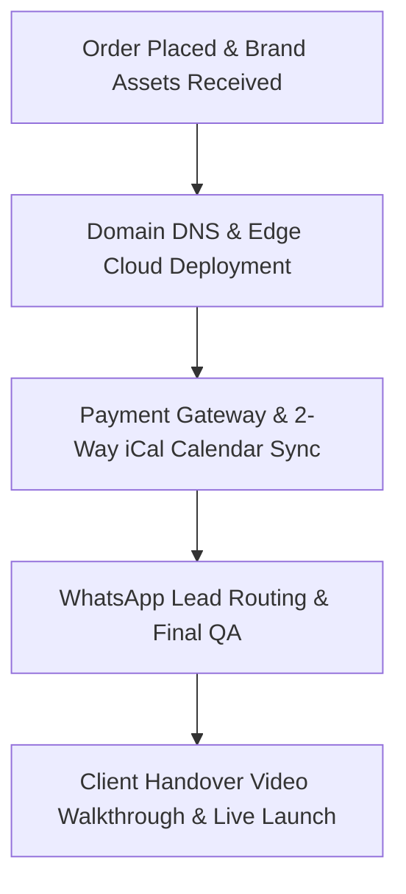

# 🛠️ 04. Tech Stack, Cloud Automations & Turnkey SLA
> **Parent Dashboard:** [[00_EXECUTIVE_MASTER_DASHBOARD]]  
> **Related:** [[01_FOUR_PILLARS_OFFER_ARCHITECTURE]] | [[05_BRAND_IDENTITY_STYLE_GUIDE]]

---

## 🏗️ Technical Architecture & Stack
PropGrowth Lab is built on modern, bleeding-edge web infrastructure engineered for speed, low maintenance, and high conversion:

- **Core Framework:** Next.js 16 (Turbopack, Server Actions, Partial Prerendering, Edge Runtime).
- **Language:** TypeScript 5.8+ (Strict Type-Checking, Zero `any`).
- **Styling & Design System:** Tailwind CSS v4 + Custom HSL Design Tokens + Framer Motion micro-animations.
- **Database & Storage:** MongoDB Atlas (Mongoose ODM) with schemas for `Lead` and `AuditRequest`.
- **Operations Console:** Internal `/admin` operations console powered by Ant Design v5 + App context.
- **Form Validation & Schemas:** Zod + React Hook Form.
- **Analytics & Tracking:** Next.js Server-Side Meta Pixel + Google Analytics 4 (Conversions API).

---

## ⚡ The 48-Hour Turnkey Deployment SLA
When a client orders a **Turnkey Deployment ($199 - $249)**, our team executes the following 4-stage protocol within 48 business hours:

### Turnkey Deployment Checklist (SOP):
- [ ] **Stage 1 (Hour 0–12): Domain & Cloud Edge**
  - Add client domain to Vercel / Cloudflare edge network.
  - Configure DNS records (`CNAME` to edge endpoint, `A` record, SSL automatic generation).
- [ ] **Stage 2 (Hour 12–24): Branding & Copy Customization**
  - Replace default branding with client's logo, color hex codes, and typography.
  - Insert high-resolution property imagery, hero photography, and amenity icons.
  - Configure room types, nightly rates, cleaning fees, and security deposit terms.
- [ ] **Stage 3 (Hour 24–36): Payment & Calendar Integrations**
  - Connect client's Stripe Connect account for direct deposit to their bank.
  - Import Airbnb & Booking.com iCal calendar export links.
  - Configure export iCal feed from our Next.js app back into Airbnb/Booking.com (2-way sync).
- [ ] **Stage 4 (Hour 36–48): Lead Bots & Live Handover**
  - Connect WhatsApp floating concierge button (`wa.me/[client-number]`).
  - Wire Telegram or Discord webhook for real-time guest booking notifications.
  - Run full end-to-end checkout test in Stripe Test Mode.
  - Record 5-minute personalized Loom handover video and deliver to client inbox.

---

## 🔄 Two-Way iCal Synchronization Mechanics
To prevent double-bookings between the client's direct website and Airbnb/Booking.com:
1. **Inbound Sync:** Next.js cron job polls the client's Airbnb iCal URL every 15 minutes. Booked dates are stored in cache and blocked on the direct website calendar.
2. **Outbound Sync:** Our app serves an endpoint `api/calendar/[propertyId].ics` that outputs standard RFC 5545 iCalendar format. Airbnb and Booking.com ingest this feed to block dates booked directly.

---

## 📱 Real-Time Lead Dispatch & Webhook Automations
When an inquiry or audit request is submitted on the platform:
1. **Database:** Lead saved to MongoDB Atlas `Lead` collection with territory tagging.
2. **Instant Push Alert:** Next.js Route Handler sends formatted payload to:
   - Telegram Channel (via Bot API).
   - Discord Private Operations Webhook.
3. **WhatsApp Concierge Link:** Dynamic link generated (`wa.me/[number]?text=[encoded-details]`) allowing the team or partner broker to respond to the lead in under 90 seconds.
